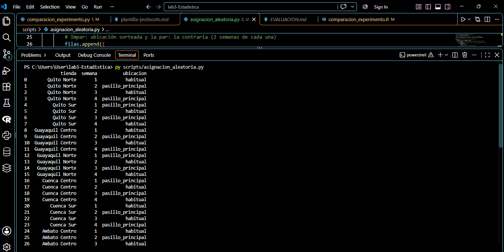
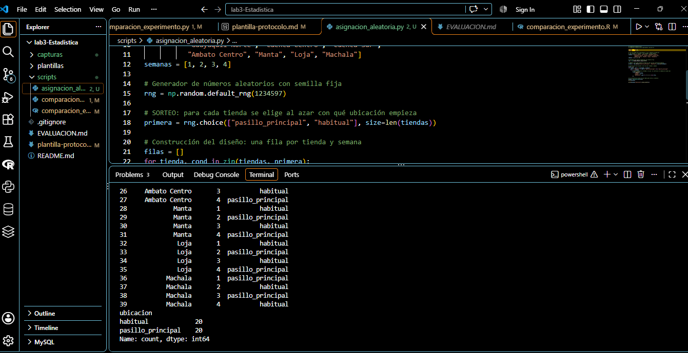
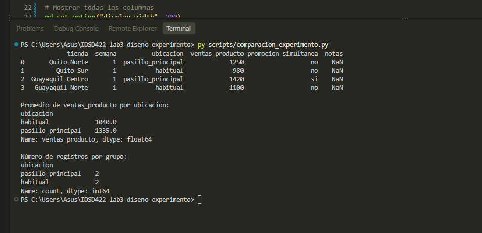

# Plantilla de protocolo — Experimento de ubicación de producto

**Nombre:** Emily Pauleth Tituaña Pulupa· **Fecha:** 13/11/2026

Completa cada sección. Usa commits por sección; la historia del repositorio se revisa.

## 1. Pregunta e hipótesis

¿Cambiar la ubicación del producto estrella al pasillo principal aumenta sus ventas?

Hipótesis: el producto ubicado en el pasillo principal (tratamiento) tiene un promedio de ventas semanales en USD por tienda (respuesta) mayor que cuando está en su ubicación habitual (control), medido durante 4 semanas en 10 tiendas.

## 2. Unidad experimental


La unidad experimental es una Semana - Tienda (**# de tiendas x # de semanas**)

- 10 tiendas x 4 semanas = 40 unidades 
- Cada tienda aparece en las dos condiciones, así que sirve como su propio punto de comparación.


## 3. Factor, niveles y tratamiento

- **Factor** (variable manipulada): Ubicaciond del producto
- **Niveles** (valores del factor): Pasillo_principal y el habitual.
- **Tratamiento** (combinación asignada): pasillos durante una semana y ubicacion habitual durante otra (grupo de control)

## 4. Grupo de control

La misma tienda pero con el producto dispuesto en suu bicación habittual.


## 5. Aleatorización

Seria por sorteo, para poder asignar. (ej de las 40 unidades las partimos en la mitad)
Sorteo de 20 tiendas a cada grupo (paralelo).

- Línea de código de la asignación (Python), ejecutada con semilla 1234597:

```python
rng = np.random.default_rng(1234597)
primera = rng.choice(["pasillo_principal", "habitual"], size=len(tiendas))
```

Script completo: `scripts/asignacion_aleatoria.py`. Resultado de una corrida:

| tienda | semana | ubicacion |
|---|---|---|
| Quito Norte | 1 | habitual |
| Quito Norte | 2 | pasillo_principal |
| Quito Norte | 3 | habitual |
| Quito Norte | 4 | pasillo_principal |
| Quito Sur | 1 | pasillo_principal |
| Quito Sur | 2 | habitual |
| Quito Sur | 3 | pasillo_principal |
| Quito Sur | 4 | habitual |
| Guayaquil Centro | 1 | habitual |
| Guayaquil Centro | 2 | pasillo_principal |
| Guayaquil Centro | 3 | habitual |
| Guayaquil Centro | 4 | pasillo_principal |
| Guayaquil Norte | 1 | pasillo_principal |
| Guayaquil Norte | 2 | habitual |
| Guayaquil Norte | 3 | pasillo_principal |
| Guayaquil Norte | 4 | habitual |
| Cuenca Centro | 1 | pasillo_principal |
| Cuenca Centro | 2 | habitual |
| Cuenca Centro | 3 | pasillo_principal |
| Cuenca Centro | 4 | habitual |
| Cuenca Sur | 1 | habitual |
| Cuenca Sur | 2 | pasillo_principal |
| Cuenca Sur | 3 | habitual |
| Cuenca Sur | 4 | pasillo_principal |
| Ambato Centro | 1 | habitual |
| Ambato Centro | 2 | pasillo_principal |
| Ambato Centro | 3 | habitual |
| Ambato Centro | 4 | pasillo_principal |
| Manta | 1 | habitual |
| Manta | 2 | pasillo_principal |
| Manta | 3 | habitual |
| Manta | 4 | pasillo_principal |
| Loja | 1 | habitual |
| Loja | 2 | pasillo_principal |
| Loja | 3 | habitual |
| Loja | 4 | pasillo_principal |
| Machala | 1 | pasillo_principal |
| Machala | 2 | habitual |
| Machala | 3 | pasillo_principal |
| Machala | 4 | habitual |

Conteo por ubicación: habitual = 20, pasillo_principal = 20.






Por qué sortear: el azar reparte entre los dos niveles, en promedio por igual, los factores que no controlamos ni conocemos (clima, eventos locales, temporada, estado del personal). Sortear con qué nivel empieza cada tienda evita que una ubicación caiga siempre en las mismas semanas, y como cada tienda se compara consigo misma, las diferencias entre tiendas no distorsionan el resultado. La semilla hace el sorteo reproducible.

## 6. Respuesta y medición

- Variable respuesta: Ventas semanales en USD
- Período de medición: 4 semanas con 2 semanas en cada ubicación por tienda.
- Quién registra y cómo (¿ciego?): Mediante el punto de venta POS, ciego (vendedor no sabria si el producto esta en principal o habitual).

## 7. Factores a controlar (mínimo 4)

| Factor a controlar | Cómo se controla o registra |
|---|---|
| Clima | Se registra por ciudad y semana. Como cada tienda pasa por las dos ubicaciones, el clima afecta a ambas |
| Evento local | Se registran feriados y eventos por tienda y semana; la semana afectada se marca para el análisis |
| Surtido / stock | Se revisa el inventario del producto cada semana y se repone para evitar quiebres |
| Cambios en el personal | Se registra la rotación del personal por tienda y semana |

## 8. Limitaciones del diseño

*¿Qué podría invalidar el experimento si no se controla? ¿Qué no se podrá concluir?*
- Pérdida de potencia por promociones simultáneas, que inflan las ventas de esa tienda-semana.
- Canibalizacion de las tiendas al mover el producto al pasillo principal puede bajar las ventas de otros productos, y este diseño solo mide el producto estrella.
- Solo 4 semanas y 10 tiendas: el resultado no se puede generalizar a otras ciudades ni temporadas.


## 9. Comparación en código (Python/R)

Script: `scripts/comparacion_experimento.py`, ejecutado desde la raíz del repositorio con `py scripts/comparacion_experimento.py`.



- ¿Qué grupo muestra mayor venta promedio en la plantilla?

El pasillo principal muestra 1335 USD de venta promedio frente a 1040 USD en la ubicación habitual.

- ¿Por qué con 4 filas no se puede concluir nada sobre el efecto de la ubicación?

Hay solo 2 registros por grupo y cada grupo tiene tiendas distintas, así que la diferencia puede deberse a la tienda y no a la ubicación. Tampoco hay asignación aleatoria ni medida de variabilidad. Además, una de las dos filas del pasillo principal (Guayaquil Centro) tenía promoción simultánea, lo que infla ese promedio y no se controla.

- Si el experimento se ejecutara con tu protocolo, ¿qué le faltaría a este análisis para ser justo?

Usar las 40 unidades tienda-semana con la asignación aleatoria de la sección 5, de modo que cada tienda pase por las dos condiciones. Con eso se promedia por tienda y se compara pasillo_principal contra habitual con una prueba t pareada, reportando el intervalo de confianza y el valor p. También habría que registrar o controlar promociones, clima, eventos locales y stock.
No se puede concluir porque no hay ninguna asignacion real aleatoria, los datos son muy pocos (4) no tenemos control de temporada, ni promociones en el grupo pasillo y no hay medida de variabilidad.

